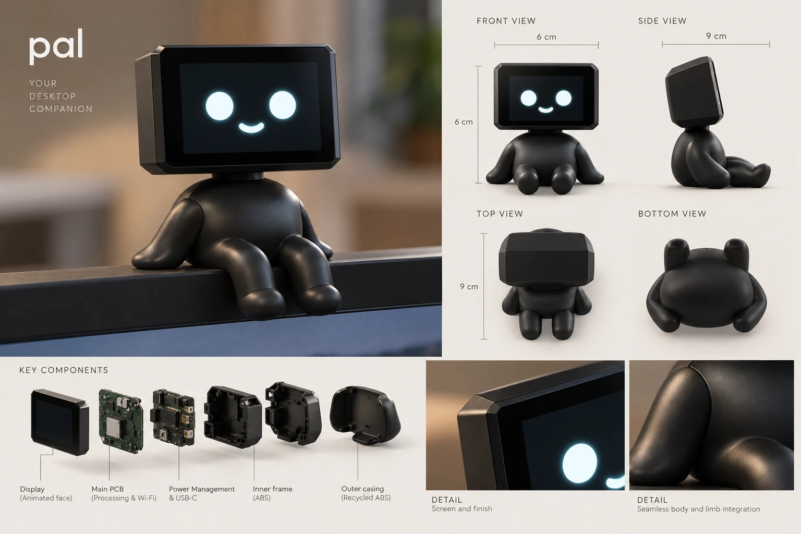

# Pal: your desktop companion

> Status: **concept**. Nothing is designed in CAD or tested yet. All numbers are proposals.

Pal is a small black robot that sits on top of your monitor and looks after you.
- It reminds you to drink water and keep your habits.
- It reads your to-do list out loud.
- You can talk to it through a built-in mic and speaker.

It powers on with your PC over USB-C. Users type their to-dos and habits into the **NRX app**, and Pal syncs with it.

## Product in one look

| | |
|---|---|
| Envelope | fits in a **60 x 90 x 60 mm** box (see [open questions](#open-questions)) |
| Look | Matte black, smooth, seamless body with a small belly. Square head with chamfered (angled) corners. Sits on the monitor edge, leaning back on its hands, legs dangling |
| Face | Screen showing only two round eyes and a banana-shaped smile, in cold white |
| Interaction | Voice (mic + speaker), touch (pat the head), the NRX app |
| Power | USB-C from the PC: Pal wakes when the PC turns on and sleeps when it turns off |

## Folder layout

| Folder | Purpose |
|---|---|
| [`design/`](design/) | Concept images, faces/expressions, colours and finish |
| [`mechanical/`](mechanical/) | Enclosure: parts, dimensions, CAD, 3D-print prototypes, final parts |
| [`electronics/`](electronics/) | Electrical architecture and BOM |
| [`firmware/`](firmware/) | Code running on Pal (ESP32-S3) |
| [`app/`](app/) | The NRX app: to-dos, habits, reminders, Pal settings |
| [`business/`](business/) | Pitch, target customers, cost and price |
| [`roadmap.md`](roadmap.md) | What we need to make Pal feasible, in order, plus the proposed decisions (local-first app, voice on the PC) |

## Workflow

The same flow as the pegboard:
1. Iterate in `mechanical/prototypes/`.
2. Once a part is print-tested and approved, promote it to `mechanical/final/`.
3. Update the cost in [`business/`](business/).

## Open questions

- [ ] **Envelope orientation.** The brief says 6 x 9 x 6 cm, but the concept sheet labels the front as 6 x 6 cm and the side as 9 cm. Which way is up: 60 W x **90 H** x 60 D, or 60 W x 60 H x **90 D**?
- [ ] Voice processing: wake word on Pal, but where do speech-to-text, answers and text-to-speech run? **Proposal: locally in the PC app, with an optional cloud mode later** (see [`roadmap.md`](roadmap.md#proposed-decisions)).
- [ ] App hosting: **proposal: a local-first desktop app with no server for the MVP**, and optional cloud sync later (see [`roadmap.md`](roadmap.md#proposed-decisions)).
- [ ] How does Pal stay seated on thin modern monitor bezels? Hands as a counterweight, a silicone base, or an optional clip?
- [ ] Final name and logo: "pal" in lowercase, as on the concept sheet?
